# AirBridge 离线文件传输系统 — 调研报告与实现方案

> **目标**：在“发送端无网无蓝牙、需手写极简 Python 代码，接收端为 Android 14 手机浏览器/离线网页”的约束下，设计一套稳定、高速、低门槛的单向光学文件传输系统。

---

## 一、五款开源参考项目横向调研

通过对 5 个目标仓库的一手源码与文档分析，各项目的定位、技术路线与可吸收精华如下：

| 项目 | 传输通道 | 编码与抗丢帧机制 | 端形态 | 核心亮点（可吸收） | 局限性（需规避） |
| :--- | :--- | :--- | :--- | :--- | :--- |
| **[sz3/libcimbar](https://github.com/sz3/libcimbar)** | 屏幕 → 摄像头（自研彩色图标矩阵） | `zstd` 压缩 → Wirehair 喷泉码 → Reed-Solomon 帧内纠错 + 交织 | 发送端 C++/WASM；接收端 Android 原生 App (`cfc`) | 吞吐天花板（~106 KB/s）；验证了**压缩 + 喷泉码 + 色彩复用**的巨大威力 | 发送端需自定义图标集、RS、交织、定位锚点，数千行 C++，**完全无法手写 Python**；接收端强依赖原生 OpenCV |
| **[Jensen-Yao/DataYao](https://github.com/Jensen-Yao/DataYao)** | 屏幕 → 摄像头（黑白 QR / RGB 三通道彩码 / 声波） | `gzip` 压缩 → 容器打包（元数据+SHA-256）→ LT 喷泉码 → 每帧 CRC32 | 全平台（纯前端 React+WASM PWA、Win32 原生、Android APK） | **接收端最佳参考蓝本**：ZXing-C++ WASM 多 Worker 解码池 + **背压丢旧保新策略** + PWA 离线缓存 + 诊断面板 + 整数倍最近邻缩放防模糊 | 标准 LT 喷泉码要求两端严格对齐 Robust Soliton 分布与 PRNG 种子，手写 Python 发送端极易敲错常量导致全盘失败 |
| **[kexing1314/QR-File-Transfer](https://github.com/kexing1314/QR-File-Transfer)** | 屏幕 → 摄像头（多码网格黑白 QR） | 固定分块 + 独立 `METADATA` 帧 + 循环播放 + 整文件 SHA-256 | 发送端 Java Swing；接收端 Android CameraX + ZXing | **多码网格（2×2 / 2×3）不改底层协议**即可成倍提速；实战经验（低帧率 3~5 FPS + 1080p 视频流命中率更高）；「查看缺失块号 + 单张补漏」；Golden 测试向量防协议漂移 | 无喷泉码，大文件尾帧补齐依赖等下一轮或手动输入块号；接收端为原生 Android App |
| **[HugStars/OfflineTransfer](https://github.com/HugStars/OfflineTransfer)** | 屏幕 → 摄像头（单张黑白 QR） | 极简文本分段 + 序号去重 + 乱序接收 | 纯静态 Web（支持浏览器插件） | **极简交互**：发送端支持方向键/空格手动翻页与单步控制，在极端反光环境下非常实用；明确提示了移动端 HTTPS 限制 | 无压缩、无喷泉码、无帧级校验，仅适合几十 KB 小文件 |
| **[aardio/qrfs](https://github.com/aardio/qrfs)** | **局域网 Wi-Fi/HTTP**（注：二维码仅作内网 URL 引导，非纯离线光学传输） | 嵌入式 HTTP/WebSocket 服务 | Windows 桌面端 (726KB) + 手机免安装浏览器 | **交互理念值得借鉴**：手机端零安装打开即用、拖拽传文件、同时兼顾**文件与文本/剪贴板快传** | 依赖局域网连通，传输机制本身不适用于物理隔离场景 |

---

## 二、核心约束分析与总体架构设计

### 2.1 核心矛盾与破局原则：**极度非对称设计（极简发送端 × 强悍接收端）**

本系统最关键的约束是：**发送端必须由人工在离线机上手写 Python 代码**。这意味着：
1. 发送端代码必须**极致精简、逻辑直白、零晦涩数学常量**（目标核心版 **40 行左右**，进阶喷泉/网格扩展仅增 **10~15 行**），尽量依赖 Python 标准库（`zipfile`、`zlib`、`hashlib`、`base64`、`tkinter`）+ 极少常见三方库（`qrcode`、`Pillow`）。
2. 接收端部署在有网环境/手机上，**没有代码长度限制**——应把所有复杂度（双引擎多线程解码、GF(2) 喷泉求解、IndexedDB 断点续传、块级进度图、摄像头对焦与变焦控制、诊断提示）全部下沉到接收端。

### 2.2 系统总体架构

```mermaid
flowchart LR
    subgraph Sender["离线发送端 (手写极简 Python)"]
        F["待传文件 / 文件夹 / 文本"] --> ZIP["内存 ZIP 打包<br/>(自动压缩+文件名+CRC32)"]
        ZIP --> CHUNK["固定切块 + SHA-256 会话ID"]
        CHUNK --> ENC["帧封装<br/>L1: 顺序帧 / L2: 自描述XOR喷泉帧"]
        ENC --> RENDER["视觉渲染 (qrcode + PIL + tkinter)<br/>单码 / 2x2多码网格 / 键盘控制"]
    end

    RENDER == "单向光学信道<br/>屏幕展示 -> 手机拍摄" ==> CAM

    subgraph Receiver["接收端 (Android 14 手机 Web / PWA)"]
        CAM["1080p 摄像头流<br/>(连续对焦 / 变焦 / WakeLock)"] --> POOL["双引擎解码层<br/>首选: 原生 BarcodeDetector<br/>兜底: ZXing-C++ WASM Worker池"]
        POOL --> PARSE["帧解析 + CRC32 脏帧拦截"]
        PARSE --> SOLVER["重组与求解引擎<br/>去重 + Peeling/GF(2) 求解<br/>+ IndexedDB 断点续传"]
        SOLVER --> VERIFY["整包 SHA-256 校验<br/>+ fflate 解压提取原文件"]
        VERIFY --> OUT["下载 / Web Share 分享 / 文本一键复制"]
    end
```



---

## 三、关键技术决策与深度设计

### 3.1 为什么用「内存 ZIP」作为统一容器？（省去 30+ 行发送端手写代码）

传统方案（如 DataYao、QR-File-Transfer）需要自己定义二进制容器头（Magic、文件名长度、UTF-8 编码、压缩标志位、文件大小、独立元数据帧等），在手写 Python 时既繁琐又容易算错偏移量。

**AirBridge 方案**：发送端直接用 Python 标准库 `zipfile` 在内存 `io.BytesIO()` 中将目标文件打包成标准 ZIP 字节流（`ZIP_DEFLATED`）：
- **一举五得**：自动完成 DEFLATE 压缩 + 原生保留 UTF-8 文件名 + 内置文件级 CRC32 校验 + 天然支持**多文件/整个文件夹打包传输** + 即使导出原始重组数据也能被任意系统直接解压。
- 发送端打包逻辑仅需 **4 行 Python 标准库代码**；接收端引入仅 ~8 KB 的 `fflate` 库即可在浏览器内存无损解压。

### 3.2 为什么默认采用「ASCII + Base64 文本帧」而非纯二进制帧？（Android 14 实战关键点）

调研与工程实践发现一个容易踩坑的平台细节：
- Android 14 Chrome 内置了系统级硬件加速的 **`BarcodeDetector` API**（底层调用 Google ML Kit，单帧解码 < 15 ms、天然支持一帧多码、手机几乎不发烫），但它**只能返回 UTF-8/UTF-16 字符串（`rawValue`），遇到非 UTF-8 原始二进制字节会被替换为 `U+FFFD` 而损坏数据**。
- 采用 **纯 ASCII 管道符帧头 + Base64 载荷**：
  - 完美兼容 **Android 原生 `BarcodeDetector` 硬件加速** + **`zxing-wasm` 兜底**。
  - 发送端只需调用标准库 `base64.b64encode`，完全避开 `qrcode` 库的 8-bit 字节模式坑和字符集编码问题。
  - 肉眼直接可读帧头，在离线机上手敲代码调试时排错成本几乎为零。
  - 虽然 Base64 有 33% 体积开销，但结合内存 ZIP 压缩与 2×2 多码网格，实际有效速率远超单码二进制；且接收端架构上可预留扩展位，未来轻松兼容 Base45（仅 3% 开销）或原始二进制模式。

### 3.3 核心创新：「自描述系统喷泉协议 (AirBridge v1)」

如何让手写 Python 既享受喷泉码（Fountain Code）“抗丢帧、免等尾帧”的优势，又**不需要手写复杂的 Robust Soliton 数学分布、不需要两端对齐 PRNG 随机数算法**？

**设计思路**：将普通数据块和喷泉冗余块统一为**自描述线性方程**：

1. **原始数据帧（`AB1`，L1 极简版仅需此帧）**：
   ```text
   AB1|<sid>|<size>|<bs>|<idx>|<crc8>|<b64_payload>
   ```
   - `sid`：完整 ZIP 流的 SHA-256 前 12~16 位十六进制，同时作为**会话 ID（防串包）**与**整包完整性校验码**。
   - `size`：ZIP 精确字节数（接收端拼完后按 `size` 截断，彻底解决末尾块零填充问题）。
   - `bs`：块大小（字节），接收端自动推导总块数 $N = \lceil \text{size} / \text{bs} \rceil$，中途随时扫码即可显示精确进度。
   - `idx`：当前块号（`0 .. N-1`）。
   - `crc8`：当前载荷的 `zlib.crc32` 8 位十六进制校验码（**100% 拦截极低概率的 QR 误纠脏帧**，防止污染喷泉方程组）。

2. **自描述 XOR 喷泉帧（`AB1X`，L2 进阶版，发送端仅多 ~6 行代码）**：
   ```text
   AB1X|<sid>|<size>|<bs>|<i1>,<i2>,<i3>|<crc8>|<b64_xor_payload>
   ```
   - **工作方式（Systematic 阶段 + 喷泉阶段）**：
     - 第一轮先按顺序发送 `0 .. N-1` 全部原始 `AB1` 帧（若信号好，一轮扫完 0 消元开销直接完成）。
     - 之后自动进入冗余轮：发送端直接用 Python 内置 `random.sample(range(N), d)` 随机抽取 $d$ 个块（如 $d \in \{2, 3, 4\}$）逐字节异或，并把抽到的块号列表 `i1,i2,...` **直接明文写进帧头**！
   - **为什么极适合手写客户端**：
     - 发送端**零 PRNG 同步要求、零浮点数学公式、零魔数表**——哪怕随手改抽样度分布，接收端照样 100% 解得出来。
     - 接收端维护一套 **Peeling（链式剥离）+ GF(2) 高斯消元** 求解器：每收 1 帧包含 1 个未知块的 `AB1X` 立即 O(1) 解出并连锁消元；尾声残留耦合方程自动触发 GF(2) 消元，彻底消除“缺最后 3 块却要干等一整轮”的痛点。

3. **双保险补漏机制**：
   - 即使发送端只手写了 L1（纯 `AB1` 循环，无喷泉），接收端也提供**一键「查看缺失块号」**（折叠区间如 `5,12-15,48`），发送端支持按提示输入缺失块号定向单播重放，几秒补齐。

### 3.4 视觉载波与发送端分层设计（按需手写，渐进升级）

发送端推荐依赖 **`qrcode` + `Pillow` + Python 内置 `tkinter`**（跨平台、无浏览器依赖；若机器已有 `opencv-python`，亦可用 `cv2.imshow` 替代 `tkinter` 进一步缩减行数）：

| 层级 | 功能范围 | 预计手写代码量 | 适用场景 |
| :--- | :--- | :--- | :--- |
| **L1 极简核心版** | 内存 ZIP 打包 + `AB1` 单码循环播放 + 键盘暂停(`Space`)/单步(`←/→`)/调速(`+/-`)/输入块号补漏 | **~40–50 行** | 应急手敲首选，3 分钟敲完，极难出错，适合 1 KB ~ 200 KB 文件 |
| **L2 喷泉抗丢帧版** | 在 L1 基础上增加 `AB1X` 自描述 XOR 冗余轮 | **+8 行** | 几百 KB ~ 数 MB 文件，免去手工补漏，边扫边自动补齐 |
| **L3 多码网格提速版** | 用 `PIL` 将 4 张独立 QR 拼成 **2×2 网格**同屏渲染（**协议零改动**） | **+8 行** | 宽屏显示器传输几百 KB ~ 数 MB 文件，吞吐提升 **2.5~3.5×** |
| **L3b RGB 彩码（可选实验）** | 将 3 张同版本同尺寸 QR 写入 R/G/B 通道 | **+10 行** | 后续作为可选实验特性，需注意屏幕色偏/白平衡干扰 |

> **渲染防坑细节**（吸收 DataYao & QR-File-Transfer 经验）：
> - 图像放大必须采用 **最近邻插值 (`Image.NEAREST`)**，禁止双线性平滑导致码点边缘发虚。
> - 保留规范白色静区（Quiet Zone ≥ 4 modules），背景纯白/深灰高对比。
> - **帧率宁稳勿快**：推荐 **4 ~ 6 FPS**（每帧停留 160~250ms），避免屏幕刷新撕裂与相机自动曝光拖影，实测有效吞吐反而高于 15 FPS。

### 3.5 Android 14 手机接收端架构与关键避坑点

> [!WARNING]
> **Android 14 浏览器摄像头安全上下文硬限制**
> 在 Android 14 的 Chrome / Edge / 系统 WebView 中，直接双击打开本地 `file://` 或 `content://` 网页文件时，浏览器会强制禁用 `navigator.mediaDevices.getUserMedia()`，**无法打开摄像头**！

为此，接收端采用 **「HTTPS 静态部署 + PWA 全量离线缓存」为主、「Localhost 本地托管」为辅** 的部署策略：

1. **首选形态：纯前端静态站点 + PWA（推荐）**
   - 部署到任意 HTTPS 静态托管（GitHub Pages / Cloudflare Pages / 个人 Nginx HTTPS 服务器），无后端依赖、零数据上传、零隐私风险。
   - 通过 Service Worker (`sw.js`) 将全部 HTML/JS/CSS 及 `zxing-wasm` 的 `.wasm` 文件缓存在手机本地；手机联网打开一次（并可选“添加到主屏幕”），此后**即使彻底断网/飞行模式也能离线打开摄像头接收文件**。
2. **纯本地无公网服务器备选**：
   - 将构建产物（或单文件 HTML）放在手机本地，通过 Termux 运行本地静态服务，访问 `http://127.0.0.1:<port>`（`localhost` 属于浏览器安全上下文，允许调用摄像头）。

**接收端核心模块设计**：
- **摄像头控制层**：
  - 优先请求 `1920×1080` 后置摄像头流（多码网格下 720p/480p 清晰度不足）。
  - 启用 `focusMode: 'continuous'`，并提供 **变焦滑块（1× ~ 3×）**（拉远手机再适当变焦能显著减少屏幕摩尔纹与反光！）。
  - 调用 **Screen Wake Lock API** 防止长传过程自动息屏。
- **双引擎解码调度器**：
  - 自动探测浏览器是否支持原生 `BarcodeDetector`（Android 14 Chrome 支持，直接硬解多码）；不支持或用户切换时无缝降级至 **`zxing-wasm` (ZXing-C++) 多 Worker 线程池**（2–4 个 Worker）。
  - 借鉴 DataYao 的 **背压丢旧保新策略**：所有 Worker 忙碌时直接丢弃中间视频帧，只送最新画面，确保 UI 60fps 流畅无延迟积压。
  - 针对 2×2 网格提供自动多码识别，并支持四象限切片并发解码模式以提高命中率。
- **持久化与交互体验**：
  - **IndexedDB 实时落盘**：每收满若干块自动保存状态，误关页面/来电切后台后重开可断点续传。
  - **块级进度热力图**：直观展示哪些块已收、哪些块缺失、实时收到高亮。
  - **多模态反馈**：收到新块可选轻微震动/提示音，完成长震动提醒，单手举手机盲扫体验极佳。
  - **诊断面板**：展示采集 FPS、解码成功数、无效/重复数；连续 2 秒无识别给出具体排查建议（距离/反光/帧率/块大小）。
  - **结果交付**：自动识别文本（一键复制/预览）与文件（一键下载 + Android 原生 `navigator.share` 分享到微信/文件管理器）。

---

## 四、性能预估与适用边界

| 传输模式 | 推荐块大小 (`bs`) | 推荐 ECC | 推荐帧率 | 预估有效速率（压缩后流） | 100 KB 代码/文本<br/>(ZIP 约 30 KB) | 1 MB 不可压缩文件<br/>(ZIP 约 1 MB) |
| :--- | :---: | :---: | :---: | :---: | :---: | :---: |
| **L1 单码模式** | 400 ~ 600 B | L / M | 5 ~ 8 FPS | **2.5 ~ 4.5 KB/s** | ~8 ~ 12 秒 | ~3.5 ~ 6 分钟 |
| **L3 2×2 多码网格** | 300 ~ 450 B × 4 | L | 4 ~ 6 FPS | **6 ~ 10 KB/s** | ~3 ~ 5 秒 | ~1.5 ~ 2.5 分钟 |

> **定位边界**：最适合 **几 KB ~ 数 MB** 的离线文件（源码、脚本、日志、文档、配置、小型依赖包、密钥/证书等）；不追求数十 MB 超大文件的极限速度（那是原生 C++ Cimbar 的战场，代价是发送端无法手写）。

---

## 五、分阶段实施计划（待确认后执行）

### Phase 1：协议冻结与 MVP 闭环（核心可用）
- 定义正式协议规范文档 `PROTOCOL.md` 与 **Golden 测试向量**（借鉴 QR-File-Transfer，锁定 Python 发送端与 Web 接收端 100% 兼容）。
- 实现 **发送端 L1 极简版**（`sender/airbridge_send.py`，严格控制代码行数、注释清晰、面向人工手抄优化，附带依赖清单与手抄速查说明）。
- 搭建 **接收端 Web 应用**（Vite + TypeScript，集成 `BarcodeDetector` + `zxing-wasm` 双引擎、`AB1` 帧解析、CRC32/SHA-256 校验、`fflate` ZIP 解压、下载/复制/分享 UI）。
- 编写两端单元测试与合成 QR 图片端到端解码测试。

### Phase 2：抗丢帧喷泉与移动端体验打磨
- 接收端实现 **Peeling + GF(2) 高斯消元求解器**（解析 `AB1X` 自描述喷泉帧）。
- 发送端提供 **L2 喷泉扩展版**（仅增 ~8 行，同时保持 L1/L2 协议完全互通）。
- 接收端完善 **块级进度热力图、缺失块号区间导出、IndexedDB 断点续传、WakeLock、变焦滑块、震动提示、诊断面板**。

### Phase 3：多码网格提速与离线 PWA 交付
- 发送端提供 **L3 2×2 多码网格模式**（可快捷键切换单码/4 码，协议零改动）。
- 接收端优化 1080p 多码并行解码，配置 **PWA（manifest + Service Worker 全量缓存 WASM）**，并额外支持构建**单文件离线 HTML** 用于本地 `localhost` 托管。
- 提供真机测试指引与参数调优手册。

---

## 六、已确认的设计决策（实施基线）

以下 4 项关键决策已确认并作为正式实现基线：

1. **发送端 Python 环境**：离线端可预装 `qrcode` 与 `Pillow`，具备图形桌面环境，使用 Python 内置 `tkinter` 弹窗渲染与键盘交互。
2. **发送端脚本形态**：只维护 **一份极致精简的统一脚本**（`sender/airbridge_send.py`，约 80 行），一站式集成内存 ZIP 打包（单文件/多文件/目录）、`AB1` 统一帧协议（顺序帧 + 自描述 XOR 喷泉帧）、1×1 单码与 2×2 多码网格实时切换、以及缺失块号精准补漏交互。
3. **Android 14 接收端部署形态**：主推 **纯前端静态站 + PWA（Service Worker 全量离线缓存含 WASM，适合部署到 GitHub Pages 或个人 HTTPS 服务器）**，同时构建 **单文件离线 HTML 产物**（适合通过 Termux `localhost` 本地托管）。
4. **核心载波范围**：聚焦 **「黑白单码 + 2×2 多码网格 + 自描述 XOR 喷泉」** 作为核心主力；RGB 三通道彩色 QR 暂不纳入，留作后续可选实验项。
